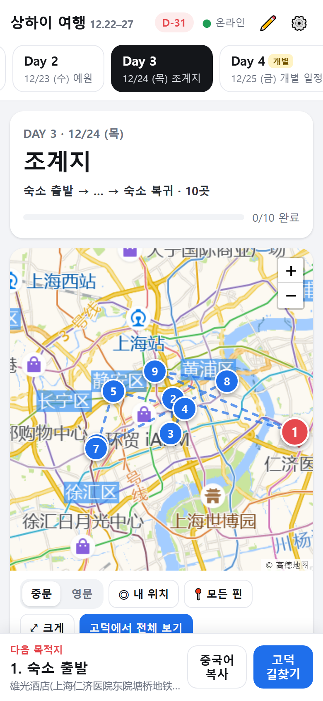
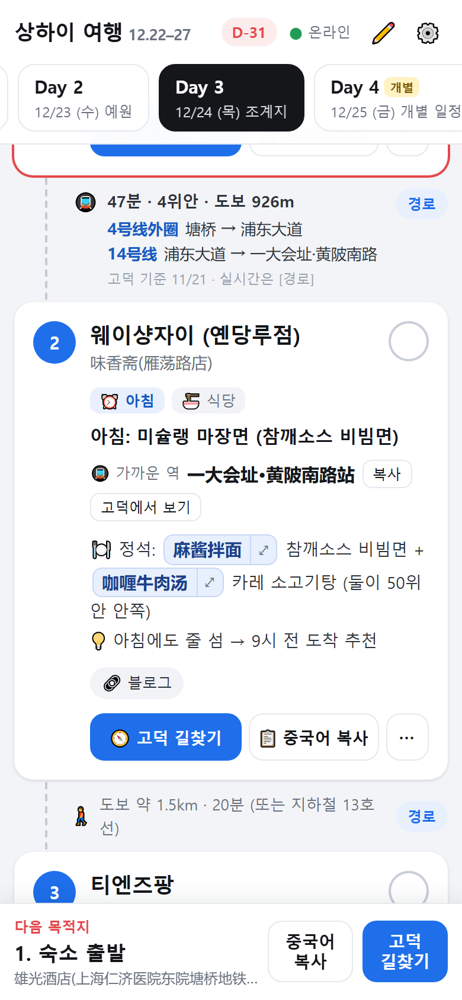
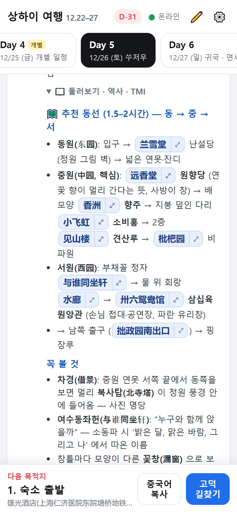
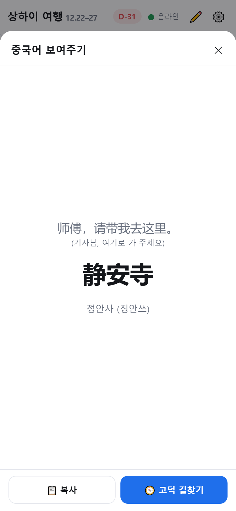
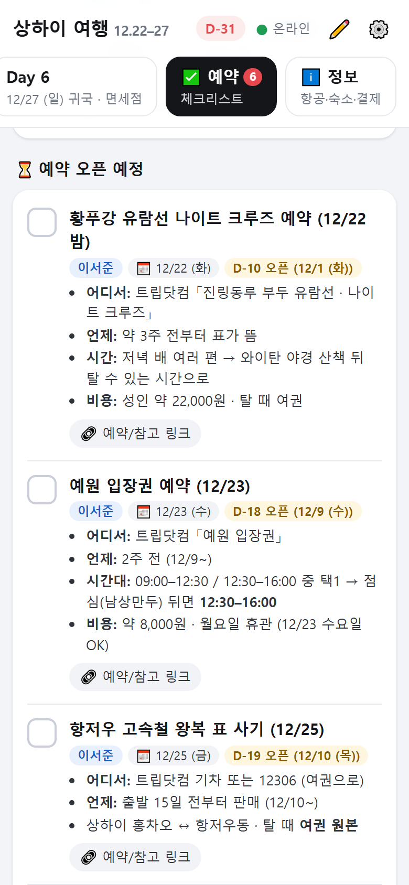
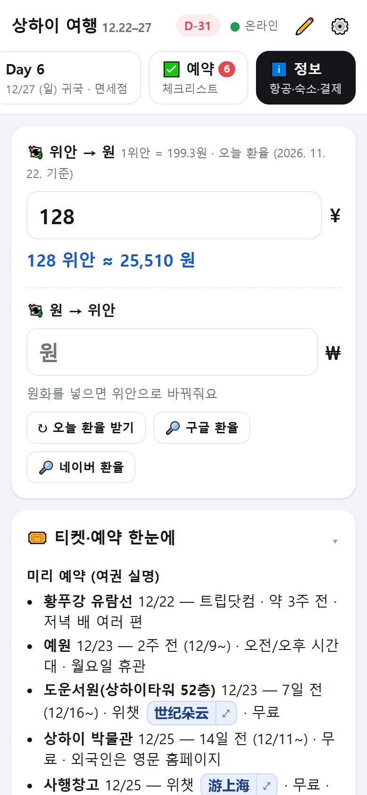

# tripApp-shanghai-2026

두 사람이 함께 쓰는 **상하이 여행 일정 웹앱**입니다.
여행 중 휴대폰에서 고덕지도(高德地图)로 바로 길을 찾고, 일정을 고치면 상대방 폰에도 바로 반영됩니다.

**▶ 앱 열기: https://pixti.github.io/tripApp-shanghai-2026/** (일정은 암호화되어 있어 여행 비밀번호가 필요합니다)


<p align="center">
  
  
  
</p>
<p align="center">
  
  
  
</p>
<p align="center"><sub>날짜별 지도 · 구간 경로 · 관광지 가이드 · 중국어 보여주기 · 예약 체크리스트 · 환율/정보</sub></p>

---

## 주요 기능

| | 기능 | 설명 |
|---|---|---|
| 🗺️ | 날짜별 지도 | 고덕 지도 위에 번호 핀과 방문 순서, 내 위치와 다음 목적지까지 거리 |
| 🧭 | 고덕 길찾기 | 버튼 하나로 고덕 앱 실행 → 현재 위치에서 대중교통 경로 |
| 🚇 | 구간 경로 | 장소 사이마다 탈 노선·승하차역·시간·요금 (고덕 기준) |
| 📋 | 중국어 복사 | 장소·역·메뉴 이름을 눌러 복사 → 고덕/디엔핑 검색에 붙여넣기, 크게 보여주기 |
| ✏️ | 함께 편집 | 순서 변경·추가·삭제·메모 → 1분 안에 상대 폰에 반영, 동시에 고쳐도 충돌 없음 |
| ✅ | 예약 체크리스트 | 예약 오픈일 D-day·당일 알림, 사람별 보기, 완료 체크 공유 |
| 📖 | 관광지 가이드 | 정원 내부 추천 동선, 역사·볼거리 |
| 💱 | 환율 | 오늘 환율 자동 반영, 위안↔원 계산 |
| 📴 | 오프라인 | 인터넷이 끊겨도 저장된 일정과 지도 표시, 수정은 연결되면 자동 업로드 |

---

## 휴대폰에 설치하기

**안드로이드 (크롬)**
1. 크롬으로 앱 주소 열기 → 여행 비밀번호 입력 → 내 이름 선택
2. 크롬 메뉴 `⋮` → **앱 설치** → 홈 화면에 아이콘 생성 (일반 앱처럼 전체화면으로 실행)
3. 플레이스토어에서 **고덕지도** 설치
4. 와이파이에서 ⚙️ 설정 → **지도 미리 저장**

**아이폰 (사파리)**: 공유 버튼 → **홈 화면에 추가**

> 중국에서는 앱 설치가 막힐 수 있으니 출국 전에 설치해 두세요. 설치 후에는 중국에서도 정상 동작합니다.

## 사용법

| 하고 싶은 것 | 방법 |
|---|---|
| 다음 장소로 길찾기 | 화면 아래 **[고덕 길찾기]** |
| 장소 사이 경로 보기 | 카드 사이 이동 정보의 **[경로]** |
| 택시·직원에게 보여주기 | 카드 `⋯` → **중국어 크게 보여주기** |
| 다녀온 곳 표시 | 카드 오른쪽 ○ (내 폰에만 저장) |
| 다른 날짜로 | 위쪽 탭, 또는 화면을 옆으로 밀기 |
| 일정 고치기 | 위쪽 ✏️ → 카드마다 수정·⬆⬇·추가·삭제 |
| 잠깐 빼기 | 카드 `⋯` → **이번엔 건너뛰기** |
| 새 일정 받기 방식 | ⚙️ 설정 → 자동 / 내가 누를 때만 |
| 고덕 앱이 안 열릴 때 | ⚙️ 설정 → **웹페이지로 열기** |

---

## 기술 구성

빌드 도구나 서버 없이 **정적 파일만으로** 동작하는 PWA입니다. GitHub Pages가 호스팅과 저장소를 동시에 맡습니다.

```
휴대폰 (PWA)                               GitHub
┌─────────────────────────┐               ┌──────────────────────────┐
│ 화면 · 편집              │   읽기/쓰기   │ Pages: 앱 파일 배포        │
│ 일정 = 암호화 파일 + 수정 │ ◀──────────▶ │ data/trip.enc.json        │
│ 서비스워커 (오프라인)     │  Contents API │ (AES-GCM 암호화된 일정)    │
└─────────────────────────┘               └──────────────────────────┘
```

- **지도**: Leaflet + 고덕 타일 (API 키 불필요). 중국 지도 좌표계(GCJ-02)에 맞춰 GPS 위치를 변환
- **길찾기 연동**: 안드로이드는 Intent로 고덕 앱 직접 실행, 그 외 기기는 고덕 웹 링크
- **보안**: 일정과 GitHub 토큰을 여행 비밀번호로 암호화 (PBKDF2 600,000회 → AES-GCM 256). 공개 저장소에는 암호문만 저장하고, 기록 메시지에도 내용을 남기지 않음
- **동시 편집**: 수정을 "작업 목록"으로 저장 → 저장 시 서버 최신본 위에 다시 적용. 같은 작업을 두 번 적용해도 결과가 같게 설계해 충돌 시 재시도해도 안전
- **오프라인**: 서비스워커가 앱 파일·일정·지도 타일을 저장. 오프라인 수정은 대기열에 두었다가 연결 시 업로드
- **지도 교체 가능**: 지도 관련 코드를 `js/providers.js`에 분리. 일정 데이터의 `trip.map` 값만 `google`로 바꾸면 구글 지도 길찾기 + 오픈스트리트맵으로 전환 (다른 나라 여행에 재사용)
- **경로 정보**: `tools/routes.mjs`가 고덕 웹 길찾기 요약에서 노선·승하차역·시간·요금을 받아 일정에 저장 (키 불필요)

---

## 개발

Node.js만 있으면 됩니다 (외부 패키지 없음).

| 실행 | 하는 일 |
|---|---|
| `preview.bat` | PC 미리보기 `http://localhost:8080` (가짜 저장소로 편집까지 시험) |
| `deploy.bat` | GitHub에 올리기 · Pages 반영 확인 (폰에서 고친 일정은 유지) |
| `routes.bat` | 고덕에서 구간 경로 새로 받기 (중국 낮 시간에만) |

```bash
node tools/trip.mjs pull     # GitHub의 최신 일정 → private/trip.json
node tools/trip.mjs check    # 일정 데이터 점검
node tools/trip.mjs push     # private/trip.json → GitHub (그사이 폰에서 고쳤으면 막음)
node tools/stations.mjs      # 오픈스트리트맵으로 장소별 가까운 지하철역 찾기
```

**처음 설정** — `private/secrets.json` (Git에 올라가지 않음)
```json
{ "pass": "여행 비밀번호", "owner": "GitHub 아이디", "repo": "tripApp-shanghai-2026", "branch": "main", "token": "github_pat_…" }
```
토큰: GitHub → Settings → Developer settings → Fine-grained tokens → 이 저장소만 선택 → **Contents**, **Pages** 를 Read and write

### 테스트

헤드리스 크롬을 휴대폰 화면 크기로 띄워 실제로 눌러보는 방식입니다.

```bash
node tools/test/unit.mjs      # 암호화, 동시 편집 병합, 고덕 링크, 좌표 변환
node tools/test/browser.mjs   # 두 기기 동시 편집·오프라인 수정·알림·스와이프 등 23단계
node tools/test/offline.mjs   # 인터넷 끊고 새로고침해도 앱·일정·지도 표시
node tools/test/desktop.mjs   # PC에서는 웹 링크로 열리는지
node tools/test/google.mjs    # 지도 제공자를 구글로 바꿨을 때
node tools/test/live.mjs      # 배포된 사이트 실제 점검 (열기 → 해제 → 저장)
node tools/screenshots.mjs    # README 화면 다시 찍기
```

### 폴더

```
index.html  css/  js/        앱 화면
  js/providers.js            지도 제공자 (고덕 / 구글)
  js/store.js  js/ops.js     저장·동기화 · 동시 편집 병합
  js/crypto.js               암호화
sw.js                        오프라인 저장
config.js                    암호화된 설정 (자동 생성)
data/trip.enc.json           암호화된 일정
vendor/leaflet/              Leaflet 1.9.4 (원본 해시 확인)
tools/                       미리보기 · 배포 · 데이터 도구 · 테스트
private/                     평문 일정·비밀번호 (Git 제외)
```

---

## 한계

- 고덕 경로 정보는 받은 시점 기준이며, 실시간 경로는 [경로]·[고덕 길찾기]로 고덕 앱에서 확인
- 일정 동기화는 GitHub에 의존 → 접속이 안 되면 저장본으로 보이고, 수정은 연결될 때 업로드
- 아이폰은 고덕 앱을 웹 링크를 거쳐 열며, 오래 쓰지 않으면 저장 공간이 비워질 수 있음

지도 © 高德地图 · © OpenStreetMap contributors · Leaflet (BSD-2-Clause)
